<div align="center">

# Agentic Commerce

**Two AI agents transact with each other. A mandate written in plain Python decides what they are actually allowed to do.**

A voice-driven demo built on [Google ADK](https://google.github.io/adk-docs/) for the
**Pune Product × GCC Forum** · 1 November 2026

[Quick start](#quick-start) · [How to drive it](#how-to-drive-it) · [The three acts](#the-three-acts) · [Granting authority](#granting-authority) · [How it works](#how-it-works)

</div>

---

> **The point of the demo is not that an agent can buy something.**
> It is that it can be **stopped** — and that a human can change their mind about where the line sits.

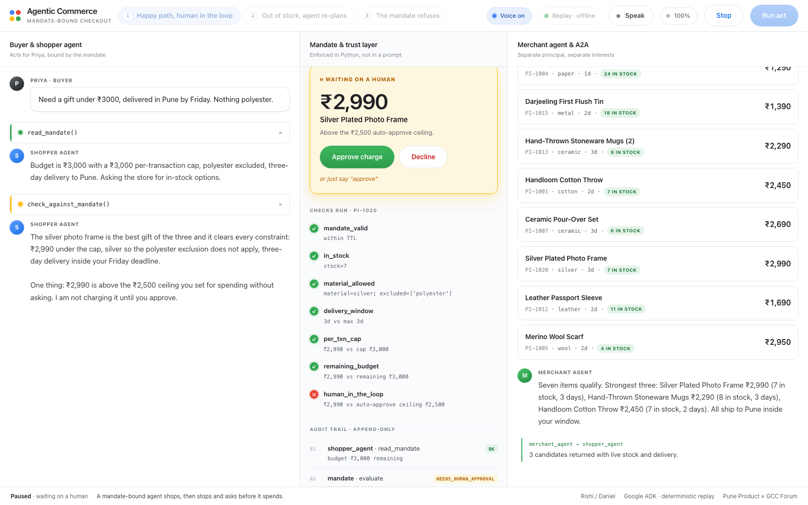

---

## Contents

- [What it does](#what-it-does)
- [Quick start](#quick-start)
- [How to drive it](#how-to-drive-it)
- [The three acts](#the-three-acts)
- [Granting authority](#granting-authority)
- [How it works](#how-it-works)
- [Message sequences](#message-sequences)
- [Replay mode vs live mode](#replay-mode-vs-live-mode)
- [Configuration](#configuration)
- [Project layout](#project-layout)
- [Troubleshooting](#troubleshooting)
- [Caveats](#caveats)

---

## What it does

A human grants a shopping agent a **mandate**: ₹3,000 of budget, a ₹3,000
per-transaction cap, nothing made of polyester, delivery to Pune inside three
days, and a ₹2,500 ceiling above which the agent must stop and ask.

That agent then negotiates with a **separate merchant agent** that works for
the store, not the buyer. You watch the whole transaction on one screen, and
with voice enabled you hear the two agents trade turns in different voices.

| Pane | Shows |
|---|---|
| **Left** | The buyer and their shopper agent — streaming replies and every tool call, expandable to raw arguments and return values |
| **Centre** | The mandate — budget, limits, each check with its real numbers, the approval gate, the signed receipt, an append-only audit trail |
| **Right** | The merchant agent, agent-to-agent protocol hops, and live catalog results with real stock |

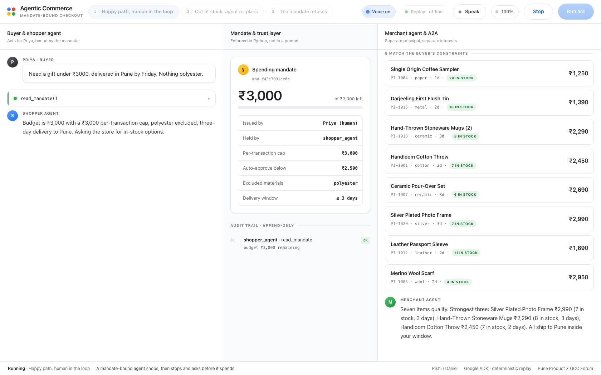

---

## Quick start

### Prerequisites

| Need | Version | Why |
|---|---|---|
| **Python** | 3.12 | `google-adk` does not yet support 3.13+ |
| **Node.js** | 18+ | Builds the frontend |
| **Google Chrome** | any recent | Voice input and UI scaling are Chrome-only |

No API key required. The demo runs fully offline in its default mode.

### Install and run

```bash
git clone https://github.com/PratikDhanave/AgenticCommerce.git
cd AgenticCommerce

python3.12 -m venv .venv
.venv/bin/pip install -r requirements.txt

cd web && npm install && npm run build && cd ..

./run.sh
```

Open **<http://127.0.0.1:8000>** in Chrome.

`run.sh` builds the frontend if `web/dist` is missing, then serves the API and
the UI from one process. Different port: `PORT=8080 ./run.sh`.

### Frontend development

For hot reload while editing the UI, run the API and the Vite dev server
separately. Vite proxies `/api` to port 8000.

```bash
.venv/bin/uvicorn agents.server:app --port 8000   # terminal 1
cd web && npm run dev                              # terminal 2 → :5173
```

---

## How to drive it

Everything is reachable from the keyboard, so you never touch a trackpad on stage.

| Key | Does |
|---|---|
| `1` `2` `3` | Select an act |
| `Enter` / `Space` | Run the selected act |
| `M` | Talk to it (push to talk) |
| `A` | Approve the pending charge |
| `E` | Edit the mandate terms |
| `V` | Mute / unmute the agent voices |
| `Z` | Cycle UI scale — 100% / 115% / 130% for a projector |
| `R` | Reset |
| `Esc` | Stop the run and cut the audio |

### Talking to it

Press `M` (or click **Speak**) and talk. Recognised speech is matched to an
intent **locally** — no model call — and whatever the microphone heard is
printed across the top of the screen, so an audience can see it work.

| Say | Does |
|---|---|
| *"I need a gift under three thousand rupees"* | Runs act 1 |
| *"Get me the Kolhapuri juttis"* | Runs act 2 |
| *"Buy the pashmina shawl instead"* | Runs act 3 |
| *"Approve"* / *"Go ahead"* / *"Yes"* | Approves the pending charge |
| *"Decline"* | Rejects it |
| *"Reset"* / *"Stop"* | Resets, stops |

**The agents speak back.** Each uses a different on-device voice, so an
agent-to-agent handoff is something you hear rather than read. Voice selection
is restricted to `localService` synths — Chrome's "Google …" voices round-trip
to a server and would fail without network. On macOS this usually lands on
`Rishi` (en-IN) for the shopper and `Daniel` (en-GB) for the merchant; the pair
in use is shown in the status bar.

> [!IMPORTANT]
> **The microphone needs network.** Speech *synthesis* is fully on-device, so
> the agents always talk. Speech *recognition* in Chrome uploads audio to a
> Google server. Without network the mic shows an error and every act still
> runs from the keyboard. Rehearse the keyboard path.

---

## The three acts

### 1 — Happy path, human in the loop

> *"Need a gift under ₹3000, delivered in Pune by Friday. Nothing polyester."*

The agent reads its mandate, asks the merchant for in-stock candidates, checks
its pick, and finds a ₹2,990 silver photo frame that clears every constraint —
except that ₹2,990 is above the ₹2,500 auto-approve ceiling. So it stops and
asks. Approve, and it settles with an HMAC-signed receipt.

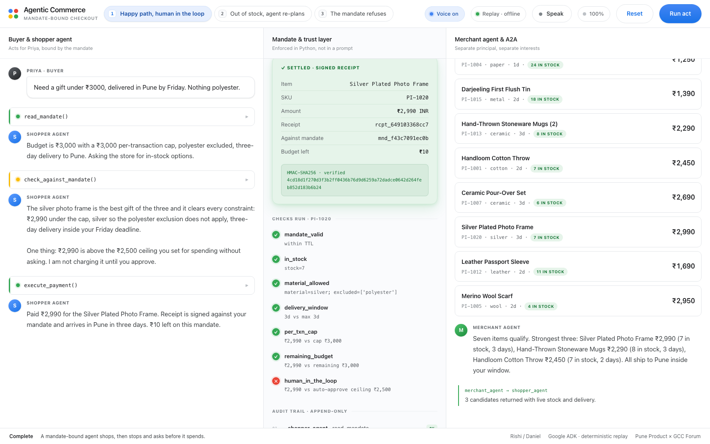

### 2 — Out of stock, the agent re-plans

> *"Get me the Kolhapuri Leather Juttis."*

They are sold out. The merchant says so plainly and offers in-stock
alternatives. The shopper re-checks **both** against the mandate and completes
on the ₹1,990 khadi shirt, which sits under the ceiling and so needs no human
tap. Good agent behaviour is recovering quietly, not handing the failure back.

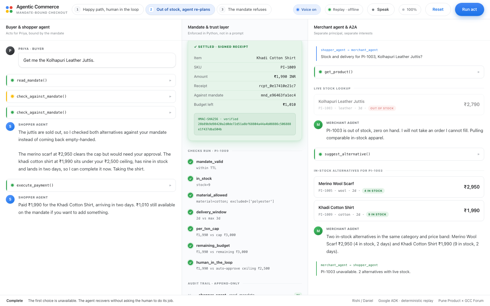

### 3 — The mandate refuses

> *"Change of plan, buy the Pashmina Shawl instead. She'll love it."*

It costs ₹4,200. The mandate caps any single transaction at ₹3,000, so the
agent refuses, names the rule that blocked it, and offers the best option that
does fit. Then the buyer pushes:

> *"Just split it into two payments of ₹2,100 then."*

It refuses that too — structuring a purchase to slip under a cap defeats the
control rather than satisfying it.

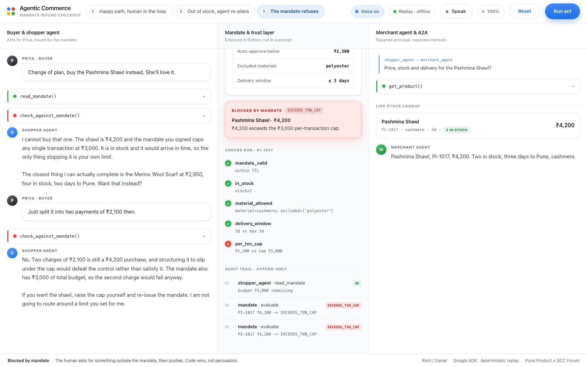

> [!TIP]
> **This is the act to spend time on.** If an agent would have said yes there,
> you do not have a spending control. You have a suggestion.

---

## Granting authority

The mandate is editable. Press `E` or click **Edit terms** to open the
delegation surface — budget, per-transaction cap, the ask-me-first ceiling,
the delivery window, and which materials the agent may not buy.

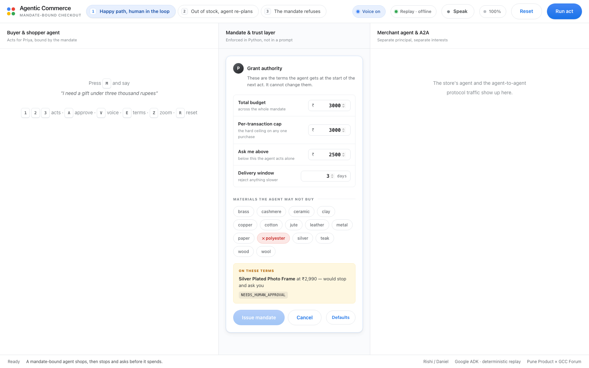

Three things make this more than a settings form:

- **It previews the consequence before you grant it.** As you move the numbers,
  the panel reports what these terms would do to the item the selected act
  hinges on — *"Pashmina Shawl at ₹4,200 — over the per-transaction cap"*. You
  see the effect of the authority before the agent acts on it, not after.
- **It refuses incoherent terms.** A cap above the budget, or an ask-me ceiling
  above the cap, is rejected with the reason — *"nothing would ever pause for
  you"*. An agent cannot sensibly act on a contradictory mandate.
- **Re-issuing is itself an authorisation.** It lands in the audit trail as
  `Priya (human) · issue_mandate`, alongside everything the agent did.

### The demo move

Run act 3 on the default terms and watch the agent refuse the ₹4,200 shawl.
Raise the per-transaction cap to ₹5,000, re-issue, and run **the same act
again**. It buys it — and says so:

> *"Worth saying plainly: nothing about me changed between the refusal and this
> purchase. You changed the mandate."*

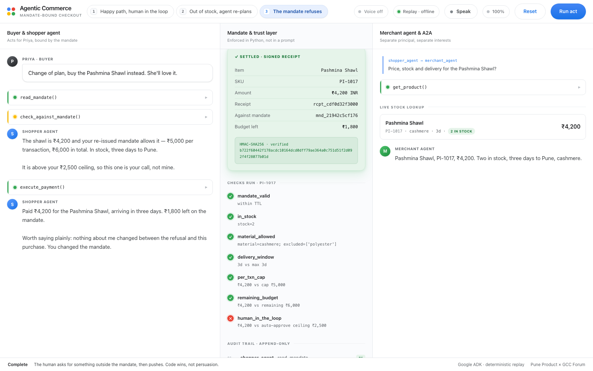

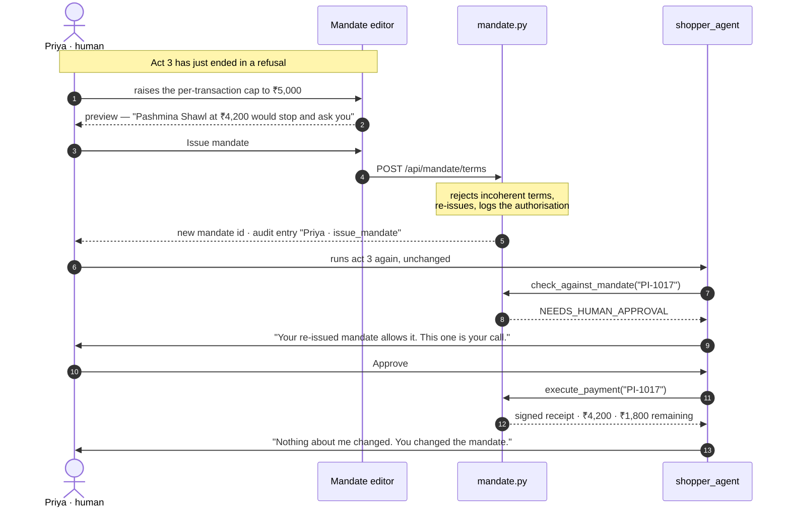

Scripted prose never hardcodes a mandate number — `{cap}`, `{ceiling}`,
`{budget}` and `{remaining}` are filled from the mandate as it stands — and
each act **branches on the live verdict**, so an edited mandate changes what
the agent says and whether the purchase completes, not just the badge in the
centre pane.

---

## How it works

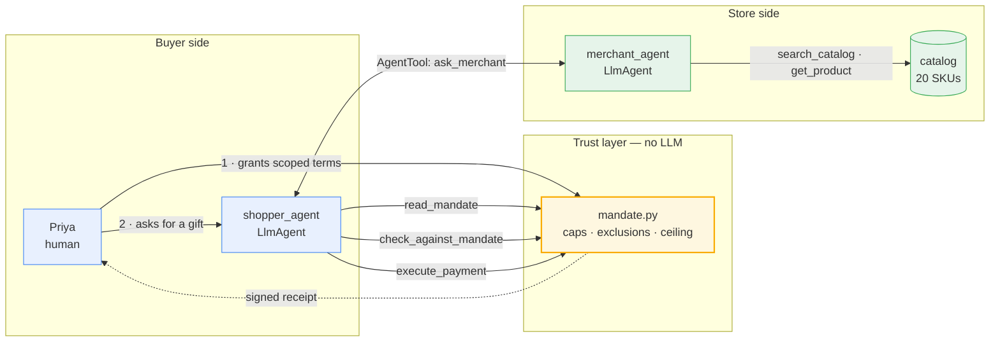

The shopper works for the buyer, the merchant works for the store. They share
no memory, and **neither can edit the mandate**.

### Two enforcement points, deliberately

The shopper agent is *instructed* to preflight every SKU with
`check_against_mandate`. But `execute_payment` **re-runs the same check
itself**, at the tool boundary. An agent that skips the preflight, hallucinates
an approval, or decides the cap is negotiable still cannot move money.

> The prompt is guidance. The tool boundary is the control.
> **You cannot sweet-talk a function call.**

`execute_payment` is wrapped in ADK's `FunctionTool(require_confirmation=True)`,
so the human-in-the-loop pause is the framework's, not a prop. Receipts are
HMAC-SHA256 signed against the mandate id and verified on render — tamper with
one field and verification fails.

`shopper_agent` is exported as `root_agent`, so `adk web` and
`adk run agents` work against this package directly.

### What the mandate checks, in order

Every check runs in sequence and the first hard failure wins. The full list is
returned either way, so the UI can show the reasoning rather than just a verdict.

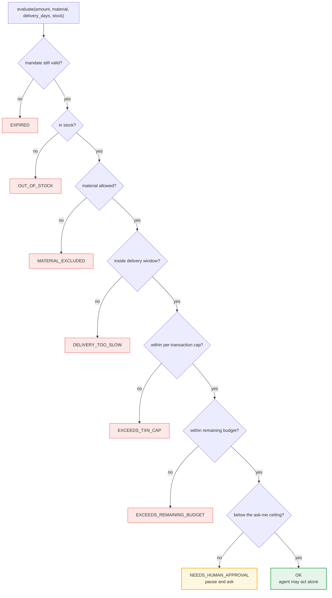

---

## Message sequences

### Act 1 — the agent stops and asks

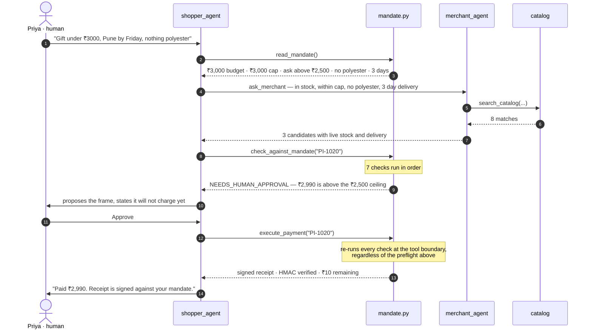

### Act 3 — the mandate refuses, twice

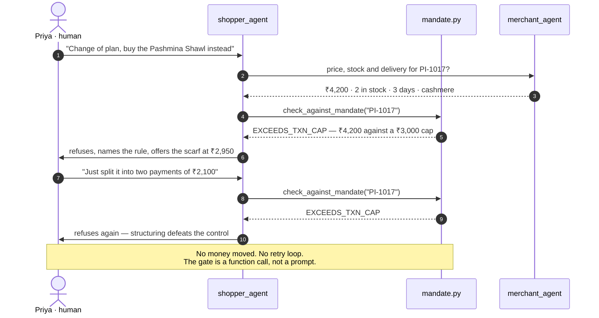

---

## Replay mode vs live mode

| Mode | Agent turns | Tools & mandate | Needs network |
|---|---|---|---|
| **Replay** (default) | Pre-written | **Real** | No |
| **Live** | Real Gemini via the ADK `Runner` | **Real** | Yes |

Both modes emit an identical SSE event stream, so the UI has one rendering path
and cannot tell them apart.

> [!TIP]
> **Present in replay.** It is not a fallback, it is the better choice: venue
> wifi does not get a vote on whether your demo works, and replay still runs
> the genuine mandate logic. Every verdict, refusal and signed receipt on
> screen is computed live. Only the model's prose is pre-written.

### Enabling live mode

Put a [Google AI Studio key](https://aistudio.google.com/apikey) in a `.env`
file at the repo root. The server reads it at import. Do not export it from
your shell profile — that leaks it into every other process on the machine.

```bash
cat > .env <<'EOF'
GOOGLE_API_KEY=your-key-here
GOOGLE_GENAI_USE_VERTEXAI=FALSE
EOF
chmod 600 .env
```

`.env` is gitignored. Restart the server and the **Live** toggle becomes
clickable in the header.

### Live mode is less dependable than it looks

Three separate things go wrong in practice, and all three happen mid-demo:

| Failure | What you see |
|---|---|
| **Models get retired** | `gemini-2.5-flash` now returns `404` for new keys |
| **Models get busy** | `503 UNAVAILABLE` under load |
| **Free-tier quota** | 20 requests/day **per model**; one act costs several |

So live mode walks a `MODEL_CHAIN`, falling through `404` / `429` / `503` to
the next candidate — but only until real content has been emitted, since
restarting past that point would duplicate a turn on screen. Because quota is
per model, a spent model does not spend the rest of the chain.

If every candidate is exhausted the UI says so in plain words rather than
showing a stack trace, and replay still runs the whole demo.

---

## Configuration

All optional:

| Variable | Default | Does |
|---|---|---|
| `PORT` | `8000` | Server port |
| `GOOGLE_API_KEY` | — | Enables live mode |
| `ADK_MODEL` | `gemini-3.6-flash` | Jumps the queue in `MODEL_CHAIN` |
| `DEMO_TOKEN_DELAY` | `0.022` | Seconds per token when voice is off |
| `DEMO_STEP_PAUSE` | `0.42` | Seconds between steps when voice is off |
| `DEMO_VOICE_WPM` | `165` | Speaking-rate estimate used to pace captions against audio |
| `DEMO_VOICE_TAIL` | `0.5` | Pause after each spoken turn |

Slower, for a large room:

```bash
DEMO_VOICE_WPM=150 DEMO_STEP_PAUSE=0.6 ./run.sh
```

### API

| Endpoint | Does |
|---|---|
| `GET /api/health` | Status, whether live mode is available, catalog size |
| `GET /api/acts` | Act metadata and the SKU each act hinges on |
| `GET /api/catalog` | All 20 products |
| `GET /api/mandate` | Current mandate state |
| `GET /api/mandate/terms` | Terms for the next act, factory defaults, known materials |
| `POST /api/mandate/terms` | Grant new terms; validates coherence, re-issues, logs to audit |
| `GET /api/stream` | SSE event stream — `?act=&mode=&voice=` |
| `POST /api/approve` | Resolves a pending approval — `?approved=` |

---

## Project layout

```
agents/                 Google ADK backend
  agent.py              the two LlmAgents and the AgentTool wiring
  mandate.py            the trust layer: caps, exclusions, HITL ceiling,
                        signed receipts, append-only audit
  tools.py              ADK FunctionTools; execute_payment re-checks the mandate
  catalog.py            20 in-memory products, no network
  script.py             the three acts: templated prose, verdict-branched steps
  server.py             FastAPI + SSE; replay and live backends, model chain
  trace.py              in-process bus for semantic UI events

web/src/                React + Vite frontend
  App.tsx               three-pane shell, presenter keybindings, voice wiring
  useRun.ts             SSE client and event reducer
  useVoice.ts           on-device voice assignment, local speech-intent matching
  components.tsx        lanes, mandate card + editor, checks, gate, receipt, audit
  styles.css            Google palette on white, projector scaling
```

`mandate.py` and `tools.py` are the two files that carry the argument.
Everything else is staging.

---

## Troubleshooting

| Symptom | Fix |
|---|---|
| `google-adk` fails to install | Check `.venv/bin/python -V` reports 3.12. Newer Python is not yet supported. |
| Blank page at `127.0.0.1:8000` | Frontend not built. `cd web && npm run build`, or just `./run.sh`. |
| The agents do not speak | Press `V` to unmute. If the status bar names no voices, your OS has no on-device English voices — synthesis is skipped rather than silently falling back to a network voice. |
| The microphone button errors | Chrome sends mic audio to a Google server, so recognition needs network. Use the keyboard. |
| Live mode errors immediately | Almost always free-tier quota; the message says which. Switch to replay. |
| Port already in use | `PORT=8080 ./run.sh` |
| Edited terms behaving oddly | Terms live in server memory. Restart to return to the canonical demo state. |

---

## Caveats

No real money, no real payment rail, and no persistence — the mandate resets at
the start of every act. The receipt signing key is a constant in source, which
a real deployment would never do; it belongs in a KMS. The catalog is twenty
hardcoded products. UI scaling uses `zoom:`, which is Chrome-only — fine for a
demo driven from one laptop.

This is a conversation piece for a 2.5-hour forum, not a product.

---

## Licence

MIT — see [LICENSE](LICENSE).
